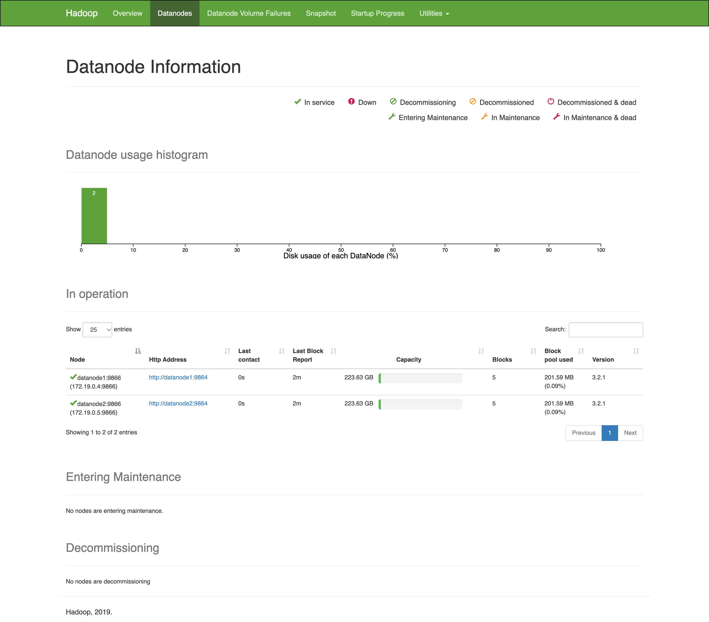
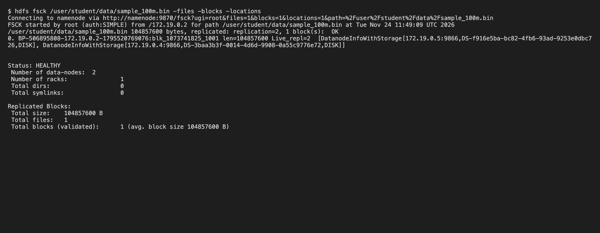
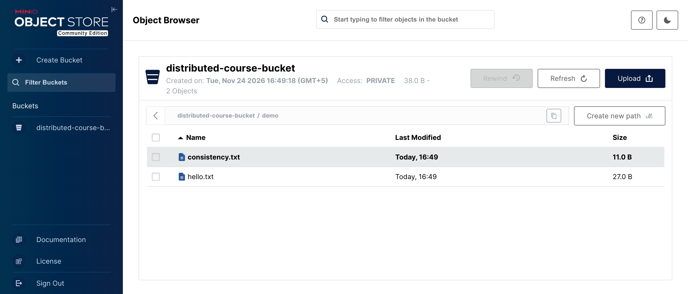
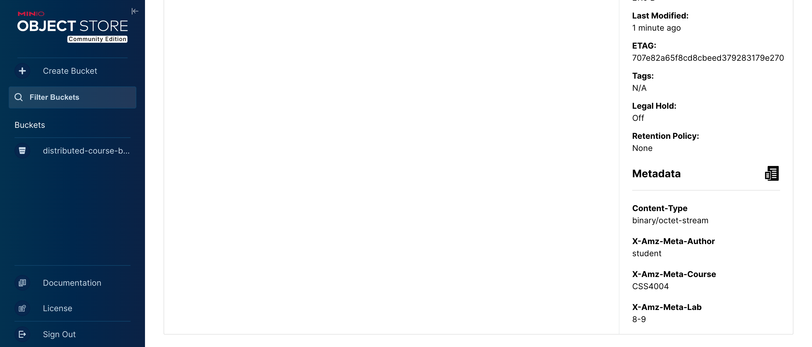
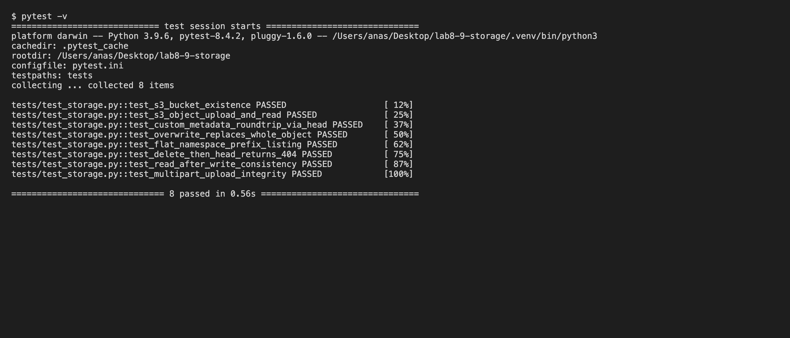
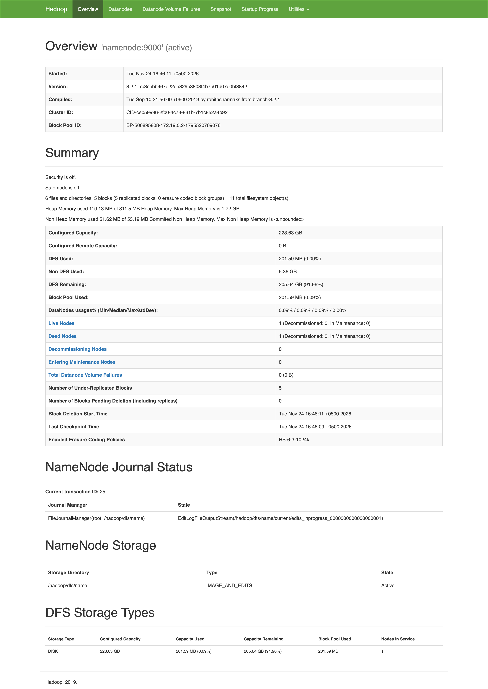

# Environment

| Component | Image / Version | Endpoint |
|---|---|---|
| HDFS NameNode | bde2020/hadoop-namenode:2.0.0-hadoop3.2.1-java8 | Web UI `http://localhost:9870`, RPC `:9000` |
| HDFS DataNodes ×2 | bde2020/hadoop-datanode:2.0.0-hadoop3.2.1-java8 | internal `:9864` |
| MinIO | cgr.dev/chainguard/minio:latest (MinIO RELEASE.2026-11-23T00-10-37Z, single node, single drive, linux/arm64) | S3 API `http://localhost:9001`, Console `http://localhost:9002` |
| Client | Python 3.9.6, boto3 1.42.97, pytest 8.4.2 | host |
| Host | Apple M4, 16 GB RAM, macOS 27.2, Docker 29.7.2 (Docker Desktop). The HDFS images are amd64-only and run **under emulation**; MinIO runs natively on arm64. | |

Configuration: `dfs.replication = 2`, default block size 128 MB. To make the fault-injection run fit into a lab session, the dead-node timeout was reduced to about 90 s (`dfs.namenode.heartbeat.recheck-interval = 30000 ms`; timeout = 2 × recheck + 10 × heartbeat = 2 × 30 s + 10 × 3 s). The default timeout is about 10.5 minutes.

**Deviation from the handout:** the image `minio/minio` can no longer be pulled (Docker Hub reports that the repository does not exist, and no tag of `quay.io/minio/minio` could be resolved either). `docker-compose.yml` therefore uses `cgr.dev/chainguard/minio:latest`, which is MinIO built from source by Chainguard. The command line, ports and credentials are unchanged.

# Section 1 — HDFS Cluster and Block Layout

## 1.1 Live DataNodes



## 1.2 Block layout (`hdfs fsck`)

Command: `hdfs fsck /user/student/data/sample_100m.bin -files -blocks -locations` (full output in `logs/hdfs_fsck_initial.log`).



**Observations**

- `sample_100m.bin` (104,857,600 bytes) is stored as **1 block** (`blk_1073741825`, len = 104857600). The whole file fits inside one default 128 MB block. HDFS does not pad the last block, so the block uses only 100 MB of disk per replica.
- The block reports **repl = 2**, with replicas on **172.19.0.4:9866 (datanode1)** and **172.19.0.5:9866 (datanode2)**. With two DataNodes and N = 2, every block has to sit on both nodes.
- Uploading the same payload with `-D dfs.blocksize=32m` gives **4 blocks** (3 × 32 MB + 1 × 4 MB). Each block is replicated independently, which shows that HDFS splits *files* into fixed-size *blocks* and spreads those across nodes.
- Total physical usage = logical size × replication = 100 MB × 2 = **200 MB** per file (the Web UI shows 201.59 MB "DFS Used" per DataNode, because both uploaded 100 MB files are stored once on each node).

# Section 2 — MinIO Objects and Custom Metadata

`python s3_client.py` creates bucket `distributed-course-bucket` and uploads `demo/hello.txt` with user metadata `course=CSS4004, lab=8-9, author=student`.





**Observations**

- User metadata travels as `x-amz-meta-*` HTTP headers on PUT. `head_object` returns it **without downloading the body**, and the keys come back lower-cased.
- The "folder" `demo/` shown in the console is not a real directory. It is a common prefix of the key `demo/hello.txt`, which the console groups using `Delimiter="/"`.

## 2.1 Automated tests

`pytest -v` → **8 passed** in 0.56 s.



| # | Test | Property verified |
|---|---|---|
| 1 | `test_s3_bucket_existence` | Bucket was created and is listed |
| 2 | `test_s3_object_upload_and_read` | PUT/GET round-trip, byte-exact |
| 3 | `test_custom_metadata_roundtrip_via_head` | User metadata persists; HEAD returns it |
| 4 | `test_overwrite_replaces_whole_object` | Immutable objects: PUT replaces the object, new ETag |
| 5 | `test_flat_namespace_prefix_listing` | Flat namespace; folders are simulated with prefix and delimiter |
| 6 | `test_delete_then_head_returns_404` | Delete lifecycle |
| 7 | `test_read_after_write_consistency` | Bounded staleness: a new version is visible on the first GET |
| 8 | `test_multipart_upload_integrity` | 20 MB multipart upload; ETag `<hash>-<parts>`; SHA-256 match |

**Test-isolation fix.** On the first run 7 of 8 tests passed. `test_flat_namespace_prefix_listing` failed because the module-scoped `prefix` fixture is shared: tests 2 and 3 had already created `test_dir/` and `meta/` under it, so the assertion "exactly `images/` and `logs/`" saw four folders. This was a test-order dependency, not a storage fault. The test now creates its keys under its own sub-prefix (`<prefix>flat-namespace/`) and keeps the same strict assertion, so the check was not weakened.

# Section 3 — Fault Injection: DataNode Termination

Procedure (`scripts/fault_injection.sh`, log: `logs/fault_injection_20261124_165156.log`):

1. Baseline: 2 live nodes, 0 under-replicated blocks, MD5 of the file recorded.
2. `docker stop hdfs_datanode1` at **T = 16:52:10**.
3. Poll `hdfs dfsadmin -report` and `hdfs fsck /` in a loop (one iteration takes about 17 s because it runs both commands).
4. Read the file while the cluster is degraded and compare MD5.
5. `docker start hdfs_datanode1`; poll until under-replicated = 0.



**Timeline**

| Elapsed (from stop) | Event | Live / Dead | Under-replicated blocks |
|---|---|---|---|
| 0 s (16:52:13) | `docker stop hdfs_datanode1` returned | 2 / 0 | 0 |
| 0–90 s | NameNode still counts the node as live (no heartbeat yet, inside the timeout) | 2 / 0 | 0 |
| 106 s (16:53:59) | Node declared **dead** (first poll that saw it) | 1 / 1 | 0 by `fsck /` (see note below) |
| 118 s (16:54:11) | Degraded read of `sample_100m.bin`, MD5 identical | 1 / 1 | 0 by `fsck /`, **5** in the Web UI screenshot |
| 238 s (16:56:11) | `docker start hdfs_datanode1` | — | — |
| 243 s (16:56:16) | DataNode is registering | 1 / 0 | 0 |
| 258 s (16:56:31) | Both DataNodes live again, 20 s after the start | 2 / 0 | 0 |

**Note on the under-replicated count.** The two views disagreed. `hdfs fsck` at 16:54:08 reported 0 under-replicated blocks and still listed both replica locations (`172.19.0.5` and the dead `172.19.0.4`, `Live_repl=2`). The Web UI screenshot, taken a short time later (between 16:54:11 and 16:56:11), showed **5** under-replicated blocks, which is every block in the filesystem (1 block of `sample_100m.bin` plus 4 blocks of the 32 MB variant). The most likely explanation is that the NameNode removes the dead node's replicas and updates its replication queue some time after it marks the node dead, but I did not isolate this. The script's `under_replicated=0` readings therefore do not mean that nothing was under-replicated.

Key log excerpt:

```
[16:51:56 +   0s] ===== PHASE 0: baseline =====
[16:52:10 +  14s] md5 before fault: 6d2b03f5c1c91c04dd1079c104f9e2c7
[16:52:10 +  14s] ===== PHASE 1: docker stop hdfs_datanode1 =====
[16:53:59 + 123s] live=1 dead=1 under_replicated=0
[16:53:59 + 123s] Dead-node detection took 106 s after docker stop
[16:53:59 + 123s] ===== PHASE 2: degraded state =====
[16:54:11 + 135s] md5 while degraded: 6d2b03f5c1c91c04dd1079c104f9e2c7
[16:54:11 + 135s] RESULT: file fully readable from the surviving replica
[16:56:11 + 255s] ===== PHASE 3: recovery — docker start hdfs_datanode1 =====
[16:56:16 + 260s] live=1 under_replicated=0
[16:56:31 + 275s] live=2 under_replicated=0
[16:56:31 + 275s] Recovery to fully replicated took 20 s after docker start
[16:56:36 + 280s] md5 after recovery: 6d2b03f5c1c91c04dd1079c104f9e2c7
```

(`+N s` in the log counts from the start of the script; the "Elapsed" column of the table counts from the end of `docker stop`, which is why the numbers differ by 17 s.)

**Analysis**

- **Detection is not instant.** The NameNode learns about failures only from missing heartbeats. Until the timeout (106 s measured here against a configured 90 s plus polling granularity, about 10.5 min by default) it still counts the node as live, and clients that pick that replica time out and fail over to the next one.
- **Availability was preserved.** The degraded read returned an identical MD5 (matched: `6d2b03f5c1c91c04dd1079c104f9e2c7` before the failure, while degraded and after recovery), because the surviving replica on `datanode2` served every block. `fsck` still reported the filesystem as **HEALTHY**. Under-replicated blocks are a durability warning. Data loss is reported only as *missing/corrupt* blocks.
- **No re-replication took place.** With 2 DataNodes and N = 2, the NameNode had no third node to copy replicas to, so the blocks stayed under-replicated until `datanode1` came back. Recovery then happened through the **block report** of the returning node, not through copying data: the node was live again 20 s after `docker start`.  The optional third-DataNode experiment (`docker-compose.datanode3.yml`) was not run.
- **Single point of failure:** losing **both** DataNodes, or the single NameNode, would make the data unavailable. Production clusters use N = 3, rack-aware placement and NameNode HA.

# Section 4 — Comparative Storage Paradigm Evaluation

## 4.1 Measured read latency

Method: `docker compose --profile bench run --rm bench`. Both systems are read over HTTP from a container on the same Docker network: HDFS through WebHDFS (NameNode → 307 redirect → DataNode), S3 through boto3 `GetObject`. Each size gets one warm-up read, then N timed reads (30 / 20 / 10 / 5). Raw samples are in `results/latency_results.csv`.

Measured values (copied from `results/latency_summary.md`; the 1 KB throughput of HDFS rounds to 0.0 MB/s):

| Size | Op | System | Median (ms) | Mean (ms) | p95 (ms) | Throughput (MB/s) |
|---|---|---|---:|---:|---:|---:|
| 1KB | GET | HDFS | 20.19 | 29.00 | 44.75 | 0.0 |
| 1KB | GET | S3 | 0.54 | 0.58 | 0.73 | 1.8 |
| 1MB | GET | HDFS | 23.67 | 26.98 | 45.36 | 42.2 |
| 1MB | GET | S3 | 1.36 | 1.34 | 1.58 | 734.8 |
| 10MB | GET | HDFS | 48.79 | 53.03 | 85.33 | 204.9 |
| 10MB | GET | S3 | 4.97 | 5.16 | 5.97 | 2013.6 |
| 100MB | GET | HDFS | 158.28 | 152.97 | 193.70 | 631.8 |
| 100MB | GET | S3 | 46.94 | 48.80 | 56.68 | 2130.4 |
| 1KB | GETFILESTATUS / HEAD | HDFS / S3 | 1.74 / 0.49 | 5.41 / 0.51 | 19.66 / 0.56 | — |

**Interpretation.** S3 was faster than WebHDFS at every size, but the gap shrinks as the payload grows: 1 KB 20.19 ms vs 0.54 ms (about 37×), 1 MB 23.67 vs 1.36 ms (about 17×), 10 MB 48.79 vs 4.97 ms (about 10×), 100 MB 158.28 vs 46.94 ms (about 3.4×). A fixed per-request cost therefore dominates small reads, and streaming bandwidth matters more for large ones. The cost on the HDFS side stays about 20 ms even for 1 KB, although the metadata lookup alone is cheap (GETFILESTATUS median 1.74 ms against 0.49 ms for S3 HEAD). So the extra time of a WebHDFS GET comes mostly from the redirect from the NameNode to a DataNode and the DataNode read path, not from the NameNode lookup. The HDFS tail is also longer (GETFILESTATUS mean 5.41 ms against a p95 of 19.66 ms). For 100 MB the difference is still about 111 ms in absolute terms, so it does not vanish for large objects.

**Caveats.** (1) The Hadoop containers are amd64 images running under emulation on an Apple M4, while MinIO runs natively on arm64. I did not measure how much of the HDFS overhead comes from the emulation, so the ratios above should not be read as a general HDFS-vs-S3 comparison. (2) Everything runs over the Docker network on one machine, so the throughput figures (up to 2.1 GB/s for S3) reflect memory and loopback speed, not disks or a real network. (3) Only 30 / 20 / 10 / 5 timed reads were taken per size. (4) Native HDFS clients (Spark, MapReduce) use the RPC protocol with short-circuit local reads and data locality, which this WebHDFS benchmark leaves out. `hdfs dfs -cat` adds about 1–2 s of JVM start-up per call and is unsuitable for latency measurement.

## 4.2 Evaluation matrix

| Evaluation Attribute | HDFS (Block Storage) | S3 / MinIO (Object Storage) |
|---|---|---|
| **Storage Hierarchy** | POSIX-like hierarchical directory tree; directories are real NameNode inodes | Flat namespace (buckets & keys); "folders" are simulated with key prefix + `/` delimiter |
| **Modification Pattern** | Write-once, **append-only**; one writer per file, enforced by a NameNode lease; no random writes | **Immutable objects**; a change is a full overwrite via REST `PUT` (a new version if versioning is on); no append |
| **Unit Size** | Files split into **fixed-size blocks** (128 MB default, 256 MB common); the last block is not padded | **Arbitrary payloads, 0 B – 5 TiB** per object; a single PUT holds up to 5 GiB, beyond that multipart (5 MiB–5 GiB parts, ≤ 10,000 parts) |
| **Metadata Management** | Central **NameNode in-memory namespace** (≈150 B of heap per file/block), persisted as fsimage + edit log | **Object key → key-value index**; MinIO has no central metadata server: it hashes the key to an erasure set and stores metadata next to the data (`xl.meta`) |
| Custom Metadata | Extended attributes (xattrs) per file | User metadata as `x-amz-meta-*` headers (AWS: ≤ 2 KB); object tags |
| Consistency Model | Strong; a single NameNode orders all namespace operations; data visible after `hflush`/close | Strong read-after-write (AWS S3 since Dec 2020; MinIO strict); **staleness observed: 2.10 ms** (one probe in `s3_client.py`: the new version was visible on the first read) |
| Fault-Tolerance Mechanism | **Replication** ×N (here 2) with rack-aware placement; the NameNode re-replicates on failure | **Erasure coding** across drives/nodes (EC:N parity). *This lab's single-drive MinIO has no redundancy.* |
| Rename / Move | Atomic O(1) metadata operation | No rename: copy + delete per object, so O(n) for a "folder" |
| Small-file behaviour | Poor: every file and block uses NameNode heap ("small files problem") | Good: billions of small objects; cost is per request |
| Access Interface | Hadoop RPC, WebHDFS REST, Hadoop FileSystem API | HTTP REST (S3 API), SDKs (boto3), presigned URLs |
| Compute Model | Data locality: compute is scheduled on the nodes that hold the blocks | Storage and compute separated; scaled independently |
| Measured read latency, 1 MB (median) | 23.67 ms | 1.36 ms |
| Measured read latency, 100 MB (median) | 158.28 ms | 46.94 ms |
| Typical Use | Batch analytics (MapReduce/Spark/Hive) on large files | Data lakes, backups, media, ML datasets, web assets |

# Conclusion

HDFS optimises for high-throughput sequential access to large files and moves computation to the data, at the cost of a centralised NameNode and weak small-file handling. Object storage gives up POSIX semantics (no rename, append or in-place edits) in exchange for a flat namespace with HTTP access and strong per-object consistency. In this lab, HDFS stayed available when one of its two DataNodes was stopped (the file was read back with an identical MD5), but it could not restore full redundancy until that node returned, because replication = 2 leaves no spare node to copy to. Measured over HTTP on one machine, S3 reads were 3× to 37× faster than WebHDFS, with the largest gap for small objects. Part of that gap may come from running the Hadoop images under emulation, so the numbers show the direction of the difference rather than an exact factor.
